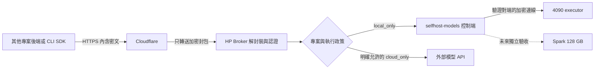

# 4090 本地模型與加密 API 接入方案

日期：2026-11-13，Asia/Taipei。狀態：**設計提案，未實作、未部署**。

保留 `https://momonong.me/quota/api/v1` 與共用 Python SDK，增加「僅限本地＋內容加密」。應用照常提交、查詢與取回工作；SDK 處理金鑰驗證及加解密。Cloudflare 轉送密文，自有 HP Broker 解密並執行權限與路由政策，4090 執行本地模型。未來 Spark 128 GB 加入同一本地資源池。

本次只交付規劃文件，不安裝依賴、不產生金鑰、不下載模型、不呼叫模型、不調整網路或服務，不修改其他專案，也不提交或發布 Git 變更。本文的參數、欄位與新增路徑均是提案，不能當成現行 1.3.0 的功能。

## 已確認需求與設計選擇

使用者已確認：

- 其他專案使用同一套 API／SDK，選擇雲端或僅限本地。
- 敏感資料不能自動改送雲端；本地離線、滿載或出錯也適用。
- 維持公開 HTTPS 入口，加入 SDK 到自有服務的內容加密。
- 金鑰管理由服務及 SDK 承擔；接入專案不自行編寫加解密或管理解密私鑰。
- 先規劃 4090；未來 Spark 為 128 GB。現在不開發。

本文提出的工程選擇：HP Broker 是內容解密端；採既有 OHTTP 請求／回應封裝；先接 Qwen3.5-4B；模型、資源、保存期及輪替週期採下列起始值。這些是設計建議，不代表使用者逐項核准了部署參數。

### 考慮過的方式

| 方式 | 優點 | 代價與決定 |
| --- | --- | --- |
| SDK 到 HP Broker 的標準加密封裝 | 同一入口、同一 SDK；Broker 可沿用能力驗證、排程與帳本 | **推薦**；HP 是受信任解密端，需增加封裝與金鑰生命週期 |
| SDK 直接加密給 4090，Broker 只轉送 | HP 也看不到正文 | 大量 admission、格式驗證及資源估算需移到 worker，跨模型路由與 Spark 擴充較複雜；不選為首版 |
| JWE 或直接 HPKE 自訂雙向封裝 | 有既有密碼學元件可用 | 還要另訂回應關聯、加密上下文與恢復規則；首版優先使用已有雙向封裝的規範，避免自行拼裝協定 |

私人連線不是此次接入前提。若日後要求 HP 也不能看到正文，須重新決定加密終點，不能只改一個設定宣稱達成。

## 現況與引用版本

本輪以以下已提交文件及程式為基準；未確認目前 GPU 服務是否運行，未重跑歷史 GPU 驗收。

| 專案 | 固定版本 | 已有能力與差額 |
| --- | --- | --- |
| api-quota-broker | `cf79ec08e3fbee968a44f4a8660c19e178e2b818` | 1.3.0 的專案 token、catalog／explain／jobs、加密佇列、穩定 request key、跨專案隔離；尚無本文的執行政策與傳輸加密封裝 |
| selfhost-models | `45ebfd57db5313292ae8f38e733f3e2894a99e5f` | Qwen／Whisper 的持久工作、GPU ownership、模型切換、lease、結果保存與恢復；真實跨主機接入、新模型及本文安全接入仍需驗收 |

Broker 的現行依據為 [開發者 API](../../developer-api.md)、[專案權限實作](../../../src/quota_broker/access.py)及[嚴格請求驗證](../../../src/quota_broker/gateway.py)。本地模型依據為同版 [接入契約](https://github.com/momonong/selfhost-models/blob/45ebfd57db5313292ae8f38e733f3e2894a99e5f/docs/client-integration.md)、[排程契約](https://github.com/momonong/selfhost-models/blob/45ebfd57db5313292ae8f38e733f3e2894a99e5f/docs/scheduler.md)及[多執行端契約](https://github.com/momonong/selfhost-models/blob/45ebfd57db5313292ae8f38e733f3e2894a99e5f/docs/multi-executor-operations.md)。

目前 Broker 的未知 task 欄位會遭拒絕；`requirements` 也只有既有 features 契約。不得把新政策藏在目前會被忽略或不具安全意義的選項中。既有 selfhost 的 `GET jobs` 不提供依 idempotency key 精確查回的公開操作，這是首次提交回覆遺失時需要補齊的對帳能力。

## 信任與資料路徑



「本地」定義為管理者驗證的自有 HP／4090／未來 Spark 信任範圍，並非呼叫者當下所在的電腦。HP 與執行模型的主機會看到執行所需的明文；不聲稱對這些主機保密，也不包含可信執行環境或遠端硬體證明。

Cloudflare 可見公開入口、IP、時間、密文大小及封裝版本／金鑰編號等外層資訊；不應取得專案 token、業務 request key、輸入、內層路由或回答正文。它可以阻斷或延遲流量，因此本方案不保證可用性或流量匿名性。Cloudflare 的 TLS 解密本身無法解開內層密文；其原有正文檢查則改由 Broker 承擔。[Cloudflare HTTP 處理說明](https://developers.cloudflare.com/data-localization/regional-services/http-requests/)

此保護以可信的 SDK、首次信任設定、金鑰與兩端設備為前提。任一端入侵、私鑰外洩、應用自行上傳資料或明文日誌不在傳輸加密的保證內。首版面向後端／CLI 的 SDK；瀏覽器從代理入口動態載入的 JavaScript 不自動具有相同信任保證。

## 模型與 4090 資源分配

本次對話已唯讀核對主機為 RTX 4090 24 GB、約 128 GB RAM、約 3 TB 可用磁碟；這是當時盤點，不代表已預留資源。主機 RAM 不能直接當作 GPU 顯存。Spark 128 GB 已由使用者確認，尚不作為目前可用容量。

| 用途 | 首批／候選 | 接入決定 |
| --- | --- | --- |
| 私有文字、資料抽取、簡短程式解釋、單圖理解 | 既有 Qwen3.5-4B／vLLM | 首批 text_generation 與受限 vision 路由；沿用已驗證資產作基準 |
| 通用品質升級 | Qwen3.5-9B 量化候選 | 比較相同任務後才切換；量化來源、revision、runtime、視覺能力及峰值顯存需共同驗證，不是只更換模型名 |
| 私有檢索 | Qwen3-Embedding-0.6B、Qwen3-Reranker-0.6B | 優先評估 CPU，另補服務與 adapter 能力；模型本身不包含文件儲存或向量資料庫 |
| 語音轉文字 | 既有 Whisper-small；Qwen3-ASR-1.7B 為升級候選 | 先保留短 WAV 基線與批次窗口；長錄音、分段、時間戳與說話者分離另驗收 |

現有 Qwen baseline revision 為 `851bf6e806efd8d0a36b00ddf55e13ccb7b8cd0a`，既有 Whisper revision 為 `973afd24965f72e36ca33b3055d56a652f456b4d`。新候選只在獲准後下載；啟動與請求不能觸發下載。圖片先遵循既有單張 inline PNG、1 MiB、1024×1024 上界；Whisper 先遵循既有 16 kHz mono PCM16 WAV、30 秒、1 MiB 邊界，不能把它宣稱為長會議轉錄服務。

起始資源提案：

- Qwen 模型與 cache 約 14–16 GiB GPU 預算，context 8192 含輸出；先一個執行工作，代表性長輸入／單圖驗證後可開到兩個。記憶體比例設定不是硬體隔離，仍需核對實測峰值。
- 同張 GPU 同時只有一個受管 deployment；ASR 採有界批次換模。既有紀錄的 Qwen load-to-ready 約 116–119 秒，頻繁切換會影響互動延遲，不把此歷史值當作現在的效能承諾。
- 本地未完成工作的起始上限為全域 8、每專案 2，包含排隊與執行；Broker 與 selfhost 接受的工作合併計數，不能各自再放大一份。排隊期限先提 15 分鐘，逾期明確終止未派送工作。
- 檢索 CPU 初始合計四個執行緒、8 GiB RAM 預算；若速度不足，另排 GPU 批次窗口，不偷占主模型資源。新 CPU worker 的 admission 不能假稱已有實測。
- 其他研究需要 GPU 時，管理者先停止新派送、排空並卸載；不搶占已執行工作，不自動停止其他專案。常駐模型即使沒請求仍占顯存。

Spark 128 GB 在架構上預留為第二個 local target，擁有獨立的模型能力、容量與排隊狀態；不能把它與 4090 的記憶體相加成單一模型預算。實機驗收前不列為可用路由，確切模型與長 context 容量另依該機實測決定。兩台上線後，尚未派送的工作可在符合模型與專案約束的本地目標中選擇；已保存派送意圖的工作固定原目標，離線或結果未知不轉到另一台重新執行。

模型資料：[Qwen3.5-9B](https://huggingface.co/Qwen/Qwen3.5-9B)、[Embedding](https://huggingface.co/Qwen/Qwen3-Embedding-0.6B)、[Reranker](https://huggingface.co/Qwen/Qwen3-Reranker-0.6B)、[Qwen3-ASR](https://huggingface.co/Qwen/Qwen3-ASR-1.7B)。上述選擇依容量、既有服務與用途推定，不以供應方榜單代替我們的品質驗收。

## 執行政策與相同 SDK 體驗

保留 `ProjectClient.catalog/explain/submit/run/status/result/cancel` 的用途及既有 outcome 讀法。下例僅示意未來介面，**不能在目前版本直接執行**：

```python
client = ProjectClient(
    base_url="https://momonong.me/quota/api/v1",
    token=project_token_from_secret_store,
    security_profile="encrypted",  # 新增提案；金鑰處理由 SDK 封裝
)
task = {
    "request_key": saved_business_job_key,
    "capability": "text_generation",
    "input": {"messages": [{"role": "user", "content": authorized_text}]},
    "execution_policy": "local_only",  # 新增提案
    "max_output_tokens": 512,
}
plan = client.explain(task)
# 使用者授權執行後，應用才呼叫 client.run(task)。
```

一般專案可明確選 `cloud_only`；敏感專案伺服器設定為 `allowed_execution=[local_only]`、`default_execution=local_only`、`encryption_required=true`。同一 project 的所有 token 使用一致政策。request 可收緊但不能放寬，省略時依已配置的專案預設；新專案必須明定預設。第一版沒有含混的 auto 模式。舊專案未遷移前保持原本 cloud_only 行為，不悄悄改成本地。

政策先於選路、估算和任何內容外送；token 計算、OCR、embedding、rerank、檔案轉換與結果後處理全部繼承。local_only 不能呼叫雲端模型、雲端 countTokens、外部文件服務或 Cloudflare Workers AI。worker 的執行環境限制外連，僅允許必要的受控內部連線；模型工具呼叫仍由應用執行，SDK 的政策不自動限制應用在其他系統的行為。

target 的 local/cloud 屬性由管理者驗證；未知不當成本地，不能依模型作者、名稱、URL 字樣或 caller 自稱來判斷。指定 provider/model 與政策衝突時拒絕，不換模型解決。catalog 同時區分已註冊、已載入、可排隊、可立即執行及阻擋原因。

policy 納入正規化業務內容、HMAC、冪等身分及持久工作。每次派送取「提交時約束」與「目前更嚴格政策」交集；政策變寬不放寬舊工作。結果與 explain 回報實際生效政策、模型及執行位置，metadata 不帶內部 IP、路徑或秘密。

## 內容加密封裝

首選 [RFC 9458](https://www.rfc-editor.org/rfc/rfc9458.html) 的請求／回應封裝，搭配 [RFC 9292](https://www.rfc-editor.org/rfc/rfc9292.html) 的 binary HTTP。密碼學由 [HPKE RFC 9180](https://www.rfc-editor.org/rfc/rfc9180.html) 的實作提供。採完整封裝，不自行修改其 key derivation、nonce 或回應關聯。本系統刻意保留專案身分，不宣稱實現 OHTTP 的匿名性目標，也不宣稱 Cloudflare 自動成為完整 OHTTP relay。

本服務固定 profile 的候選套件為 X25519／HKDF-SHA256／AES-128-GCM；SDK 與伺服器只接受已驗證的固定清單，不能由外層 header 任意指定演算法。初始候選實作為 Rust `ohttp` 的 client/server 元件及相容 bHTTP 元件，SDK 提供封裝好的 Python wheel。候選依據是其公開 API，尚未完成安全維護、授權、Python packaging 或目標平台驗證。[ohttp 元件文件](https://docs.rs/ohttp/latest/ohttp/)

後續實作前須確認候選版本及相依公告，跑規範測試向量與跨實作相容性，確認能提供既有 SDK 支援環境的預建 wheel；不能讓接入專案自行編譯加密核心。若此路線不合適，停在相依選型，提出另一個成熟實作方案，不直接改成自製 HPKE 協定。首版只支援既有 buffered jobs，不另加 SSE／realtime。

### 外層與內層

API root 不變，提議新增：

| 外層路徑 | 內容與用途 |
| --- | --- |
| `GET /quota/api/v1/crypto-config` | 無秘密的簽章金鑰設定；不含 token、prompt 或專案內容 |
| `POST /quota/api/v1/encrypted` | `message/ohttp-req`，只承載標準密文；合法封裝回 `message/ohttp-res` |

所有 catalog、explain、提交、狀態、列表、結果與取消操作，在 encrypted profile 都包成獨立內層 HTTP 訊息。內層包含原方法／路徑、Authorization、Date、傳輸識別及 JSON 正文；外層不帶專案 bearer、業務 key 或模型參數。附件使用現有有界 inline 格式，結果及含業務資訊的錯誤也加密。

Broker 解封裝後只允許同一固定 authority、既有公開 API 的指定操作，直接送到內部 dispatcher。拒絕任意主機、absolute URL、管理路徑、CONNECT、redirect、巢狀 encrypted 路徑與不允許的 headers；它不是通用 HTTP proxy。

認證與專案政策在解封裝後、接受業務工作前執行。encryption_required 的 token 在原明文應用層 routes 一律不能執行或取回內容；來源是否已加密由入口自行標記，不能信任 caller 傳入的普通 header。新 token 須安全發放；已曾在外層傳送的舊 bearer 不能被視為從未暴露給代理，安全升級需更換該憑證。

本方案的新 SDK client 預設 encrypted，且不提供切回 plaintext／legacy 的選項；一般專案的 cloud_only 也走加密。因此 SDK 在第一次傳送 token 或內容前就確定保護要求，不等待伺服器看過明文後才拒絕。矛盾的設定、未知 profile 或不支援加密的舊 server 都在傳送業務資料前失敗。舊 SDK 與現行 JSON routes 可繼續服務未遷移的非敏感專案；敏感專案遷移時更換憑證並只配置給新版流程。伺服器拒絕明文請求無法撤回代理已看到的 token；應用自行繞過 SDK 洩露憑證不在本保證內。

同一 encrypted client 的 cloud_only 操作也使用封裝，避免把相同專案 token 暴露在外層。加密只保護到 HP；明確選 cloud_only 後，HP 仍會將所需明文交給被允許的模型供應商。

### 錯誤、大小與流量保護

SDK 只有在驗證解封裝成功後，才將內層 response 映射為現有結果或 ClientError。外層 HTTP 200 不是成功證據；偽造、調包、截斷、錯誤 content type、未加密 response 都不能視為可信業務回覆。送出可能已發生的 POST 遇外層錯誤，維持 outcome unknown，只查原工作，不因 404／422／503 自動改用另一把 key 重送提交。

解密前的失敗只回有限固定代碼，不回顯封包、token 或輸入；成功解封裝後的專案／工作錯誤用加密回覆。加密、金鑰或版本不合時不降級成明文，也不切私人入口或外部模型嘗試恢復。

兩端仍驗證外層 TLS，不跟隨 redirect、不使用環境中未指定的 proxy。Cloudflare 保留連線層與可用 metadata 防護；Broker 對解密成本、並行 handler、讀取時間、密文大小、內層解碼大小、JSON 深度與每專案工作數設獨立上限。密文上限由部署的明文總界限加封裝開銷推導，不能把密文大小當原始輸入的配額。首版關閉封裝壓縮，不用壓縮來繞過大小限制；padding 可作後續改進，不承諾隱藏流量大小。

## 金鑰管理與專案接入

| 類型 | 保管與用途 | 輪替及恢復 |
| --- | --- | --- |
| 離線信任根簽章私鑰 | 管理者離線保管；簽發受限設定簽章金鑰；不放 Cloudflare、GPU worker 或應用 repo | 根輪替經受信任的 SDK／設定發放流程；根疑似外洩時需重新建立獨立信任 |
| 設定簽章金鑰 | 自有管理元件，與推論 worker 分開權限；只能簽指定服務的短效 public manifest | 初始委派有效期提案 30 天；輪替交接由管理流程完成，SDK 驗證根簽章與用途 |
| HPKE 接收私鑰 | HP 的解封裝元件；不交給 Cloudflare、其他專案或 4090 | 初始每日輪替；舊 key 有界接收重疊後刪除，不納入一般備份 |
| 專案 token | 應用既有秘密注入與 Broker 的專案政策；只在內層認證 | 可撤銷、可同 project 更新；舊／新 token 政策一致，不共用 Owner token 冒充不同專案 |
| 內部連線與儲存金鑰 | HP／4090 各自受控，與傳輸 key 分離 | 各依用途輪替；傳輸 key 淘汰不能破壞已接受工作的結果查詢 |
| 每次請求的短期上下文 | SDK 與 HP 的暫存記憶體，由標準元件建立 | 每次呼叫重新建立；不用跨程序保存，也不讓應用自行管理 nonce |

簽章設定採標準 JWS 與固定 Ed25519 profile；簽原始 payload bytes，避免自行發明 JSON canonical signature。只接受固定 alg、用途與信任鏈；忽略／拒絕不受信任的 jku、x5u 及遠端 key locator，不讓 header 自行指定信任根。[JOSE 的 Ed25519 規範](https://www.rfc-editor.org/rfc/rfc8037.html)

### 初次發放與自動更新

1. 由管理者登錄 project、執行範圍、加密要求、容量與內容保存政策；發放專案 token 到既有秘密管理機制，不在聊天、文件或一般日誌傳遞。
2. 官方 SDK／受控的專案設定預先帶入服務信任根公鑰與精確 audience。信任根必須來自獨立可信的套件或管理端發放路徑，不能接受 crypto-config 自稱的根。應用可固定 SDK 版本／雜湊，私鑰不隨套件發放。
3. SDK 從同一 HTTPS 入口取得已簽章設定，驗證 issuer、服務 origin／路徑、profile、金鑰用途、有效期及版本。設定簽章元件無權簽任意跨服務 key。
4. SDK 自動快取與更新公鑰。初始設定有效期提案 15 分鐘、快取最多 10 分鐘；上次已接受的單調版本保存在無秘密的本機狀態，拒絕回退。重新安裝沒有歷史版本時仍須驗證簽章、audience 與短有效期。
5. 更新不可達時，只使用仍有效且未撤銷的已驗證設定；過期後拒絕新呼叫，沒有 trust-on-first-use 或明文 fallback。作業系統時間必須可信，不依未驗證的外層 Date 自動校時。

每日 HPKE key 切換需先公布新 key、保留短暫舊 key 接收窗口。窗口至少覆蓋已簽設定最長有效期、允許時鐘誤差及在途 HTTP 時間，初始提案 20 分鐘；外層 key ID 在仍可接受的集合中不能碰撞。新版本設定只發布新 key 作為加密選擇；仍持有有效舊快取的 SDK 可在該設定到期前使用舊 key，到期後必須更新或停止，不能無限沿用快取。

被代理封鎖的撤銷資訊不能保證即時送達。在設定簽章私鑰仍可信的前提下，短設定有效期限定舊設定可繼續被接受的窗口。HP 側可立即停用受損接收 key、撤銷 project token 並停止接受新工作。此時可用性優先讓位給停止接受不可信流量。

設定簽章私鑰若外洩，攻擊者可能持續簽出新的短效設定；15 分鐘有效期不能限制這類攻擊。若撤銷被攔截，SDK 最晚須在根所簽的委派期限屆滿時停止接受該 signer，不能接受 signer 自行延長授權；30 天委派因此代表最壞情況可能長達其剩餘有效期。事故處理須透過獨立可信的 SDK／管理設定更新撤銷該 signer、解除受損設定造成的版本鎖定，再接受根授權的新 signer。更新送達前停用受影響 client；HP 拒絕舊 key 不能阻止攻擊者假冒入口讀取新請求。若需求不能接受此窗口，必須在上線前縮短委派期限或另設獨立撤銷通道，不能宣稱既有短 manifest 已解決。

如果某把 HPKE 接收私鑰外洩，使用該 key 的歷史密文可能被解開，包含內層 bearer token；除換 key 外，還須撤銷／輪替可能暴露的專案憑證並核對相關存取。設定 signer 外洩也按可能收到假接收 key 的 client 範圍輪替憑證。每日接收 key 輪替與刪除可縮短風險窗口，**不是完整前向保密**。根 key 外洩須重新獨立發放信任；不能只換 HPKE key 宣稱恢復。金鑰刪除範圍包含備份與診斷副本；不承諾能清除已被攻擊者取得的副本。[HPKE 安全限制](https://www.rfc-editor.org/rfc/rfc9180.html#section-9.7.4)

### 應用需做與不需做的事

應用只需安裝支援此 profile 的 SDK、設定既有 base URL 與自身 token、選 execution_policy、持久保存自己的業務 request key。管理者負責信任設定與憑證發放，SDK 負責驗證公鑰、輪替、封裝、回應驗證及錯誤映射。

應用不需要產生／保存長期解密私鑰、交換回應公鑰、計算 nonce 或自己實作加密 HTTP。一般純 HTTP 範例無法直接以原始 JSON 使用此模式；文件提供官方 SDK／CLI 路徑，不能要求其他專案各自複製加密程式。新增 SDK 的打包與平台需求須在接入文件中明列。

## 非同步工作、冪等與防重播

每個 HTTP 呼叫各自建立加密上下文；提交收到 job metadata 即結束該次上下文，SDK 等待時以新的加密呼叫查詢原工作。執行結果保存在自有服務，取結果時再加密給該次請求。因此應用重啟後，只需可用的專案憑證、信任設定與原 request key；不依賴提交時留在記憶體中的解密狀態。

兩層識別分開：

- **傳輸識別**：短期 Date 與標準封裝的唯一值用於防重播。接受時間窗暫提 2 分鐘；在更長的有界持久窗口內記錄已接受封包，重啟不清空而讓其再次生效。窗口滿、時鐘不可信或狀態不可用時停止接受，不靜默省略檢查。
- **業務識別**：project＋request_key＋正規化工作內容／政策維持長期冪等。不能對每次不同的密文計算業務內容身分。相同 key 修改內容、執行政策或模型約束仍衝突；credential 輪替及公鑰輪替不是新工作。

Broker 在持久保存 dispatch intent、完整本地 deployment 與 selfhost idempotency identity 後，才提交一次本地工作。須新增受限的唯讀查回契約，能以此已保存身分查到原 selfhost job／收據；查詢結果要區分存在、已收集及未知／不能證明未建立。不能用「查不到」推定先前沒執行，也不能在 selfhost GC 後重新 POST 當作重試。

本地成功僅在運算終止且 `result_state=available` 後映射為可取回 outcome。HTTP 斷線、cancel、lease 逾時、worker 離線不表示 GPU 已停止。只恢復原工作的查詢與結果保存，不跨 worker、模型或雲端重派。Broker 與 selfhost 各自保留其責任範圍的權威狀態，adapter 持久保存對應，不複製另一份可獨立派送的業務佇列。

公開 cancel 先維持現行「尚未派送可取消」語義；一旦下游接受工作，不把取消回覆當作資源已釋放。若將來擴充中止功能，另定契約及驗收。

## 儲存、觀測與內部網路

傳輸加密不取代磁碟保護。HP 的 queue、4090 control 的 input/result/receipt 與 executor 暫存副本均須盤點；現有 selfhost 預設七天保存不能直接當作敏感資料政策。首批敏感工作上線前，要確認這些新內容副本具受控的加密儲存與存取權限；延用已驗證的儲存加密元件，key 與 HPKE key 分開。舊的未提交工作、資料與歷史驗收紀錄不由本計畫刪除或改寫。

正常完成後，輸入在無讀者、依賴或恢復引用時回收；結果可取回期暫提完成後一小時。HP 與下游須使用一致的期限與清理確認。UNKNOWN、未 ACK 的唯一結果或 storage_failed 的唯一收據不能被一般 TTL 盲目刪除；它們屬加密恢復資料，需管理者對帳，不宣稱一小時內所有副本必然消失。最小防重送 metadata 與正文分開保存且有容量上界，容量不足拒絕新工作，不刪去重證據騰空間。

新敏感輸入／結果與短期傳輸私鑰不進一般備份；需復原的最小帳本與儲存 key 以獨立受控流程備份。內容遺失時回報 unavailable，不重新生成冒充舊結果。部署前需驗證原有磁碟快照、APM、錯誤追蹤及 core dump 不會意外保存新明文副本。

只記錄必要的工作狀態、實際模型／部署版本、token 用量、排隊／載入／執行時間及錯誤代碼；不記 prompt、附件、tool arguments、token 或完整回答。執行 wall time 不冒充實測 GPU compute seconds，未量測成本保持未知；本地容量使用 slot／隊列／維護狀態，不能偽造供應商無限額度。

HP 到 4090 只允許固定服務身份、固定目標與驗證對端的加密通道，不接受任意外部 URL 或明文 LAN 呼叫。第一版沿用現有架構，selfhost 的 control／executor 權限分離，模型 worker 不公開。實際通道、ACL 與主機服務狀態由後續部署階段讀取 selfhost-servers 的固定現況契約後決定；本文件不授權開 port、改 Tunnel/Caddy 或重啟服務。

## 後續工作順序與驗收條件

下表是未來工作分界，不是本輪已執行的測試。

| 順序 | 工作 | 必須取得的證據 |
| --- | --- | --- |
| 1 | 加密相依與契約確認 | 固定版本、規範向量與跨實作驗證、必要平台預建 wheel；無自製密碼學核心 |
| 2 | 離線 SDK／Broker 封裝與政策 | 同一 API root；所有敏感操作與 token 加密；錯誤、公鑰回退、plaintext downgrade、密文調包與跨專案讀取均被拒絕 |
| 3 | 本地持久 adapter 與容量整合 | 首次回覆遺失仍能查原工作；重啟／TTL／GC／UNKNOWN 不重派；共享 GPU 所有權與 queue 界限一致 |
| 4 | 經授權的受控 4090 驗收 | 先合成文字與單圖；量測顯存、等待、載入、完成與排空；沿用固定 4B 資產，不干擾其他研究 |
| 5 | 經授權的正式入口驗收 | Cloudflare 只見封包、不見 token 或正文；內部通道與存放副本逐段核對；proxy 仍可造成拒絕服務，不誤報成功 |
| 6 | repo 外接入驗收 | 在獨立環境只依文件安裝 SDK、注入專案 token，完成 local_only＋加密；一般專案另以明確 cloud_only 驗證同一 SDK，不修改其他專案本體 |
| 7 | 能力與品質擴充 | 代表性私有工作比較 4B／9B；embedding、rerank、ASR 各自完成能力與產品品質驗收後才上 catalog |

特別需要覆蓋：

- local_only 在 worker offline、滿載、OOM、timeout、不支援能力、金鑰過期或輪替失敗時，雲端 transport 的內容派送次數為零；前處理也納入。
- `execution_policy` 被改成 cloud_only、body／回應被改寫、回應換到另一請求、同密文重播、同 key 換明文、同 token 跨 project、舊 SDK／舊 server 不支援時，一律保持安全拒絕。
- 日常金鑰輪替、簽章委派到期、撤銷被代理延遲、應用／Broker 重啟、已提交後外層偽造錯誤，不能造成降級或第二次推論；受損 signer 不能越過根授權期限，事故恢復須處理偽造高版本與受影響憑證。
- SDK 在網路 POST 已可能送出後，仍只查原工作；換 key 只可用於新的查詢封裝，不等於允許重新提交業務工作。
- 日誌、HTTP 錯誤、metrics、trace、結果保存、受管備份與 GPU 工作清理都不能靠「已使用 HTTPS」代替逐項證據。

安全協定與身分／金鑰設計需獨立審查；本文件的完整性審查不是密碼學稽核證書。品質驗收以文件摘要、資料抽取、簡短程式解釋及單圖理解為首批工作，記錄可用率與錯誤類型，不承諾未量測的 tokens/s 或前沿模型等級。

## 目前結論與後續決策界線

已確認的方向足以進入後續實作規劃：同一 HTTPS 入口與 SDK、HP 為可信解密端、4090 為第一個本地執行端、敏感專案強制 local_only＋加密、金鑰由平台與 SDK 管理。

精確加密相依版本／wheel 可行性、主機間通道、資源峰值與模型品質屬實作前或部署前必須取得的證據，不冒稱已確認。本文的一小時結果保存、每日傳輸 key 輪替及資源上限是起始提案，可依實際需求調整；調整不能放寬已確認的資料外送限制。

使用者若後續授權，才開始實作計畫及相應程式工作。Git 提交／合併／推送、金鑰生成與發放、GPU 工作、網路配置及正式部署各自依當次授權進行。
